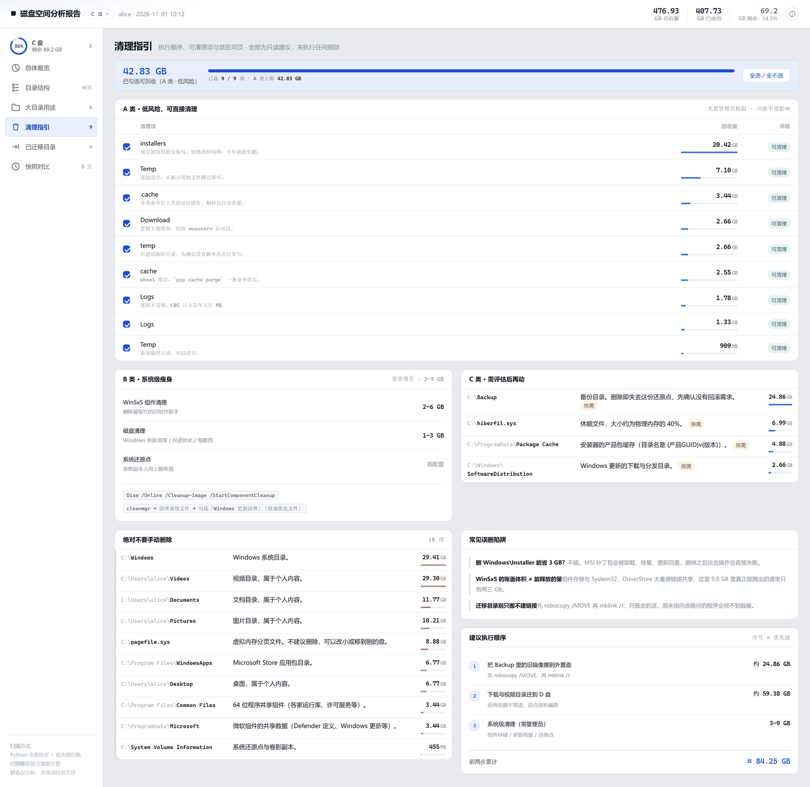

<div align="center">

# DiskAudit

**Windows 磁盘空间分析工具 —— 只读扫描，逐层下钻，生成本地清理报告**


</div>

体积可以扫描计算，目录是什么用途、删掉会有什么后果，不能。
DiskAudit 把两件事分开：**数字层**每次现算，**文字层**由一份不绑定机器的通用规则库兜底，
本机特有的缺口整理成 ticket，由人工或 AI 填写后导回，报告自动更新。


扫描全程只读，程序无任何联网行为。报告既能通过本地服务实时下钻，也能打包成单个 HTML 分发。

## 目录

- [设计原则](#设计原则)
- [功能](#功能)
- [快速开始](#快速开始)
- [常用命令](#常用命令)
- [报告界面](#报告界面)
- [文档](#文档)
- [隐私与安全](#隐私与安全)
- [已知限制](#已知限制)
- [常见问题](#常见问题)
- [参与贡献](#参与贡献)
- [许可证](#许可证)

## 设计原则

| 原则 | 具体做法 |
|---|---|
| **只读** | 扫描不移动、不删除、不重命名任何被扫描内容，写入只发生在工具自己的 `data\` |
| **本地** | 无上传、无检查更新、无遥测；服务只监听 `127.0.0.1`，对外分享用离线单文件 |
| **不猜** | 程序只产出数字，不推断目录用途；缺说明的目录汇总成 ticket，补不补都能出报告 |
| **分层** | 扫描、文字、渲染三层各管一段，中间只通过 `data\` 与 `content\` 的文件交接 |
| **可回溯** | 每次刷新归档一张按盘隔离的快照，能对比涨跌、指认到最深的目录或大文件 |

## 功能

- **目录树按体积排序**，逐层展开，每层末尾以「其余零散项」收尾，占比合计 100%
- **目录用途来自规则库**：65 条精确路径、63 条名字规则、7 条路径规则，匹配顺序为精确路径 → 名字规则 → 路径规则 → 祖先继承
- **Junction / 符号链接单独统计**，实测目标体积，汇总已迁出空间
- **清理清单按风险分 A / B / C 三档**，勾选后实时计算可回收总量，同页给出执行顺序、禁区与误删陷阱
- **快照对比**：涨跌榜、首次收录、不再收录、任意目录的体积趋势与逐层下钻指认
- **ticket 自包含**：缺说明的目录汇总成一份可直接交给对话模型的文件，填完放回即自动导入
- **两种交付方式**：本地服务实时查看并下钻，或打包为无任何外链的单文件 HTML

## 快速开始

**环境**：Windows 10 / 11 · PowerShell 5.1+ · Python 3.8+。把仓库克隆或复制到任意目录即可，
无需安装步骤，也无需虚拟环境。

**1 · 双击 `start.bat`**

首次运行会提示选择磁盘，随后执行全量扫描（耗时取决于文件数量，通常数分钟），
初始化知识库、生成 ticket，并启动 Web 服务：

```text
  选择要刷新数据的磁盘（本机 2 个）：

  1) C: · Windows · 476.93 GB · 已用 85.5% · 剩 69.16 GB · 尚未扫描  [默认 · 系统盘]
  2) D: · Data · 1024.00 GB · 已用 62.1% · 剩 388.10 GB · 尚未扫描

  输入序号或盘符（回车 = C:，q 退出）：

  首次运行：先扫描一遍磁盘（取决于文件数量，通常几分钟）
  ------------------------------------------------------------
  [tree]    节点 ...
  ------------------------------------------------------------

  待完善：N 条目录说明 → content\drives\<盘>\ticket.md

  DiskAudit · http://127.0.0.1:8765/
```

**2 · 浏览器会自动打开报告**，默认地址 `http://127.0.0.1:8765/`。
端口被别的程序占用时会自动顺延到 8766、8767…，窗口里打印实际地址，浏览器也开在新地址。

**3 · 想补全目录说明**（可选）：把 `content\drives\<盘>\ticket.md` 整个发给任意对话模型，
填好 `- 说明：` 与 `- 评级：` 后覆盖原文件，下次启动自动导入并生成下一批。

后续启动只执行三步：检查 ticket 是否被改动、导入已改动的 ticket、启动服务。

## 常用命令

| 我想… | 命令 |
|---|---|
| 查看报告 | `start.bat` |
| 刷新数据、文字层并后台重建离线版 | `update.bat` |
| 不重扫，只刷新文字层 | `update.bat --skip-scan` |
| 换一块盘 | `update.bat --drive D:`，或点页面顶栏的盘符 |
| 指定端口（被占直接报错，不自动顺延） | `start.bat --port 9000` |
| 不打开浏览器 / 打印每个请求 | `start.bat --no-browser` / `start.bat -v` |
| 打包单文件离线版 | `python scripts\build.py` |

根目录的两个 `.bat` 只负责定位 Python 并转发给 `scripts\app.py`：
`start.bat` 等价于 `python scripts\app.py`，`update.bat` 等价于 `python scripts\app.py --update`。
`update.bat` 完成后即退出，不启动服务、不打开浏览器；离线版在后台构建，日志写入 `data\.build.log`
（`--no-build` 可跳过）。退出码 0 表示正常，2 表示扫描失败但文字层仍按旧数据刷新完成。

`--skip-scan` 跳过整个扫描阶段，仅用 `data\` 中已有数据；数据缺失时直接报错，不会静默生成空报告。

完整参数、换盘的三种方式、扫描门槛与离线版细节见 **[使用手册](docs/usage.md)**。

## 报告界面

页面左侧一条导航切换六个面板：

| 面板 | 内容 |
|---|---|
| **概览** | 容量环、物理内存与 hiberfil / pagefile 的比值、顶层目录构成、可回收合计 |
| **目录结构** | 树形展开，每行带体积、占比和一句用途，右侧固定卡跟随选中目录 |
| **大目录用途** | 六个顶层目录各一行，右边把体积拆到子项上 |
| **清理指引** | A / B / C 三档清单、系统级清理命令、禁区与误删陷阱、建议执行顺序 |
| **已迁移目录** | 扫到的 Junction 和符号链接，实体在哪个盘、实测多大 |
| **快照对比** | 两版之间的涨跌榜、首次收录、不再收录，以及任意目录的体积趋势 |

<details>
<summary>展开全部界面截图（示例数据：476.93 GB 的 C 盘、账户 alice）</summary>

| | |
|---|---|
|  |  |
|  |  |
|  |  |

</details>

## 文档

| 文档 | 内容 |
|---|---|
| [使用手册](docs/usage.md) | 启动与刷新、全部命令行参数、换盘、扫描参数、离线单文件、完整 FAQ |
| [文字层与知识库](docs/content-layer.md) | ticket 流程、`purpose.json`、`report.json`、占位符、`linkextra.json` |
| [架构与接口](docs/architecture.md) | 数据流、快照与多盘、HTTP 接口、目录结构 |
| [隐私与安全](docs/privacy.md) | 只读保证、写入清单、无联网、环回监听、免责声明 |
| [开发指南](docs/development.md) | 测试、路径自检、页面回归、编码与提交约定 |

想理解「为什么用途说明要人工补」从 [文字层与知识库](docs/content-layer.md) 开始；
想接接口或改代码从 [架构与接口](docs/architecture.md) 开始。

## 隐私与安全

- 扫描全程只读；写入只发生在工具自身的 `data\`（快照与盘留档，界面中可删除）
- 程序无联网行为：不上传扫描结果、不检查更新、无遥测，所有数据仅存于本机
- 服务默认仅监听 `127.0.0.1`，请勿通过 `--host` 绑到局域网；对外展示请用离线单文件
- `data\`、`content\` 和 `dist\` 的离线报告都包含账户名、盘符与完整目录结构，
  **分享它们等同于分享一份本机数据画像**

体积为实测值，「可回收」合计、目录用途与 A / B / C 评级为估算与推断：硬链接、簇大小、
系统还原点都会让实际释放的空间与报告数值有偏差。本工具仅提供清理参考，
删除范围与执行方式由使用者自行判断，据此操作造成的数据丢失或系统问题，本工具不承担责任。

详见 [隐私与安全](docs/privacy.md)。README 顶部的徽章由代码托管平台渲染时加载，与程序运行无关。

## 已知限制

- 只支持 Windows：采集层依赖 PowerShell 和 NTFS 链接语义
- 首次扫描较慢，数百万文件的盘需要数分钟；之后仅刷新文字层，速度很快
- 离线单文件不支持实时下钻和任意两版对比
- 只统计体积，不查找重复文件，也不读取文件内容
- 「可回收」是估算：硬链接、簇大小、系统还原点都会使实际释放的空间小于报告数值

## 常见问题

**ticket 填完放回去没生效**
只有指纹匹配才会导入：文件须保存为 UTF-8，且不能改动标题或重排小节。
改坏了也不丢数据 —— 删除该盘的 `ticket.md` 并重启，会按当前缺口重新生成。

**提示端口上跑着另一个 DiskAudit**
默认端口 8765 被占用时会自动顺延到下一个空闲端口并打印实际地址，无需手动换端口；
顺延途中遇到本目录已在跑的 DiskAudit 会直接打开它，不再起第二个进程。
显式写了 `--port 9000` 则严格按指定端口来，被占就报错并给出可用的替代端口。

**报告里的账户名、盘符不是我本机的**
重新执行 `update.bat`。路径全部来自本次扫描结果，不会残留旧值。

更多问题（打开 `web\index.html` 提示没有数据、ticket 里没有我关心的目录、
PowerShell 参数默认值异常、`.bat` 报「不是内部或外部命令」等）见
[使用手册 · 常见问题](docs/usage.md#常见问题)。

## 参与贡献

欢迎提 Issue 和 Pull Request。动手前请注意：

- 行为变更后同步更新 `scripts\test_*.py`，提交前跑一遍全量测试
- `.ps1` 存为 UTF-8 **with BOM**，`.bat` 存为 GBK（cp936）**无 BOM** 且保持 CRLF
- 不要提交 `data\`、`dist\`、`content\` 里的任何内容（含本机路径与目录结构）
- 提交信息不要写入本机路径、进程名或 PID

测试命令、自检工具与页面回归流程见 [开发指南](docs/development.md)。

## 许可证

以 [MIT](LICENSE) 发布 © 2026 Cealvia。

报告内嵌的图表库为 [Apache ECharts](https://echarts.apache.org/)，采用 Apache License 2.0，
授权与声明见 [`assets/LICENSE.txt`](assets/LICENSE.txt) 与 [`assets/NOTICE.txt`](assets/NOTICE.txt)。
