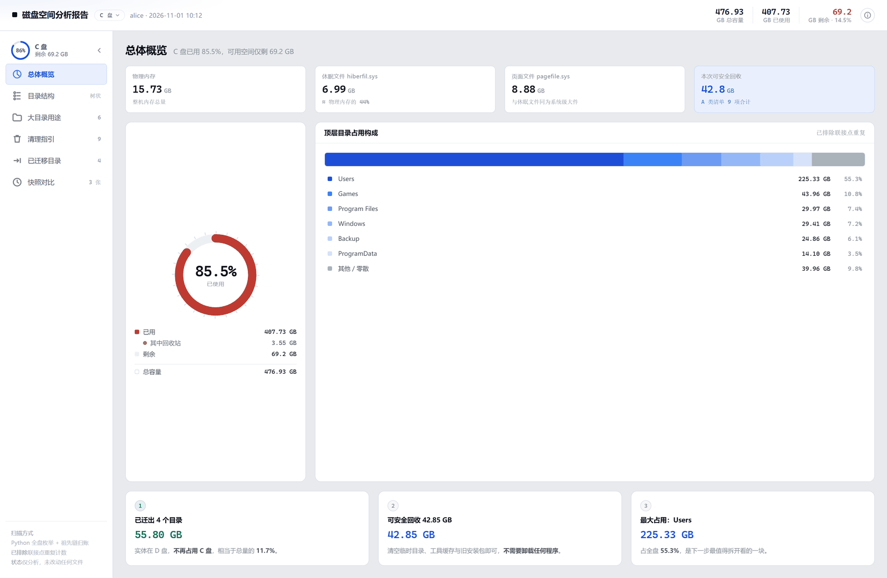
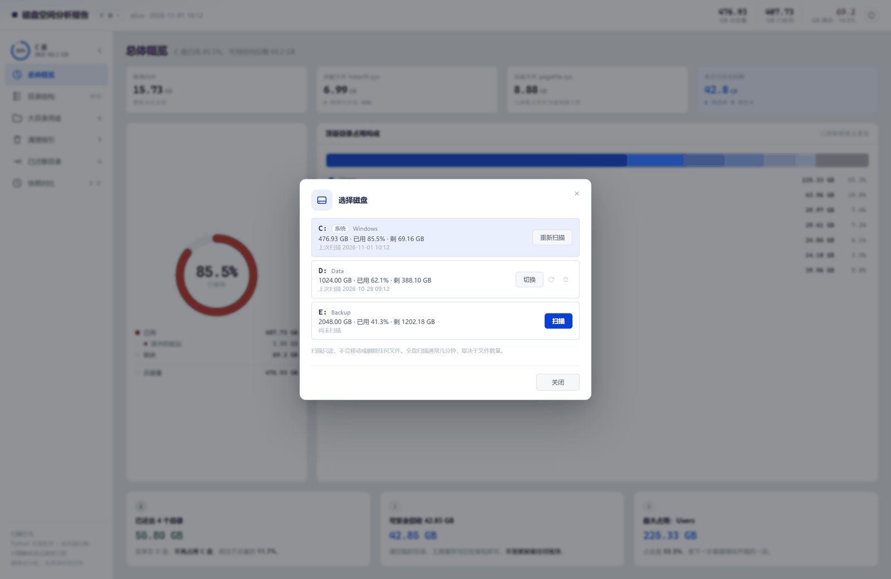
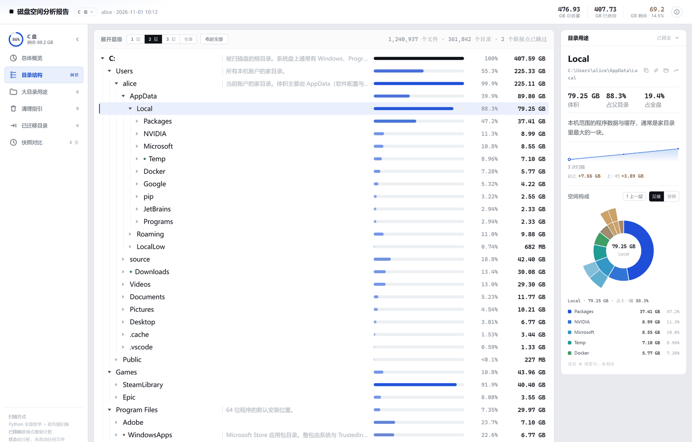
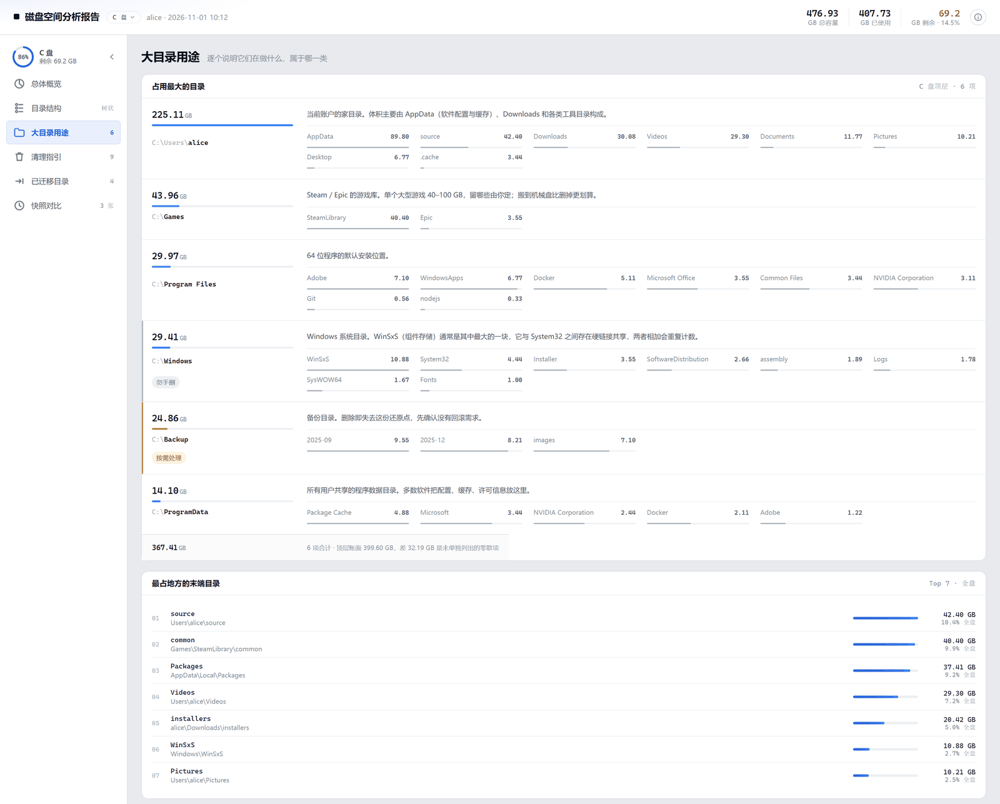
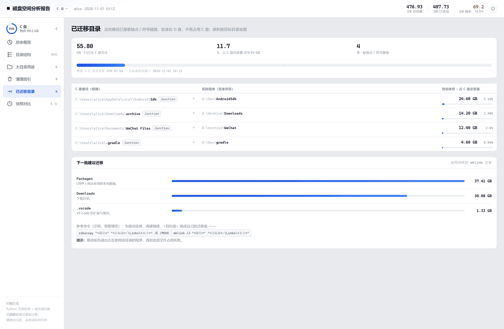
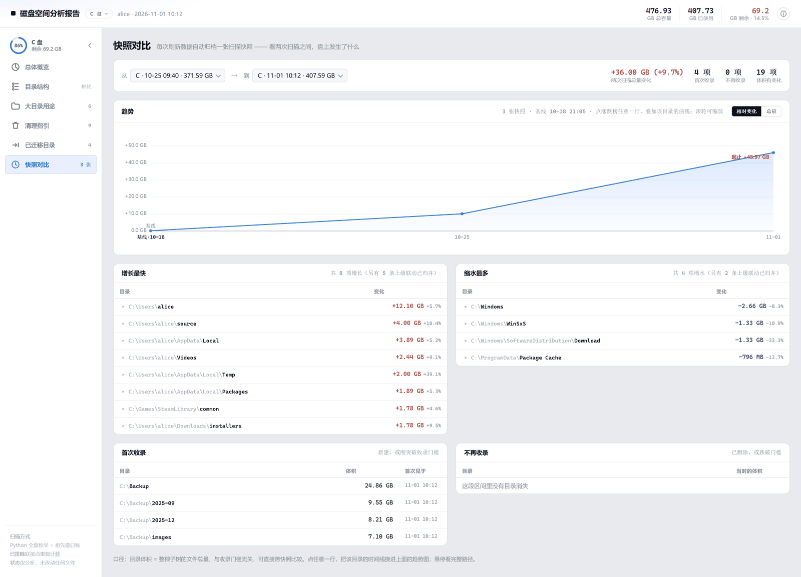

# DiskAudit

Windows 磁盘空间分析工具。只读扫描目录树，按体积排序，生成可逐层浏览的清理报告。

体积、占比、盘容量等数字由每次扫描计算；目录是什么用途、删除会有什么后果，无法从扫描
结果推导。程序自带一份不绑定机器的通用规则库兜底，机器特有的缺口整理成 ticket，由人工
或 AI 填写，导回后报告自动更新。

**环境**：Windows 10 / 11 · PowerShell 5.1+ · Python 3.8+



## 功能

- 目录树按体积排序、逐层展开，每层末尾以「其余零散项」行收尾，占比合计 100%
- 目录用途来自一份不绑定机器的规则库：65 条精确路径、63 条名字规则、7 条路径规则，
  匹配顺序为精确路径 → 名字规则 → 路径规则 → 祖先继承
- Junction / 符号链接单独统计，实测目标体积，汇总已迁出空间
- 清理清单按风险分 A / B / C 三档，勾选后实时计算可回收总量，同页给出执行顺序、禁区与误删陷阱
- 每次刷新归档一张快照，两版对比提供涨跌榜、首次收录、不再收录与体积趋势
- 缺说明的目录汇总为一份自包含的 ticket，补全后放回原处即可自动导入
- 可启动本地服务实时查看并按目录下钻，也可打包为单个 HTML 分发

## 用法

将仓库克隆或复制到本地任意目录即可运行，无需安装步骤，也无需虚拟环境。

双击 `start.bat`。首次运行会提示选择磁盘，随后执行全量扫描（耗时取决于文件数量，通常
数分钟）、初始化知识库、生成 ticket，并启动 Web 服务：

```
  选择要刷新数据的磁盘（本机 2 个）：

  1) C: · Windows · 476.93 GB · 已用 85.5% · 剩 69.16 GB · 尚未扫描  [默认 · 系统盘]
  2) D: · Data · 1024.00 GB · 已用 62.1% · 剩 388.10 GB · 尚未扫描

  输入序号或盘符（回车 = C:，q 退出）：

  首次运行：先扫描一遍磁盘（取决于文件数量，通常几分钟）
  ------------------------------------------------------------
  [tree]    节点 ...
  ------------------------------------------------------------

  待完善：N 条目录说明 → content\drives\<盘>\ticket.md

  DiskAudit · http://127.0.0.1:8765/
```

后续启动仅执行三步：检查 ticket 是否被修改，导入已修改的 ticket，启动服务。

根目录的两个 `.bat` 只负责定位 Python 并转发给 `scripts\app.py`：

| 脚本 | 等价命令 | 说明 |
|---|---|---|
| `start.bat` | `python scripts\app.py` | 启动服务查看报告 |
| `update.bat` | `python scripts\app.py --update` | 刷新数据与文字层，先提示选择扫描盘；后台生成离线版，不启动服务、不打开浏览器 |

`update.bat` 先提示选择扫描盘，完成后即退出，流程为：扫描 → 补齐文字层 → 生成 ticket →
后台重建 `dist\磁盘空间分析报告.html`。后台构建无需等待，日志写入 `data\.build.log`。
双击运行时结束后等待按键，以参数方式调用则直接退出。退出码 0 表示正常，2 表示扫描失败
但文字层仍按旧数据刷新完成。

参数直接透传：

```powershell
start.bat --port 9000            # 换端口
start.bat --no-browser           # 不打开浏览器
start.bat -v                     # 打印每个请求
update.bat --skip-scan           # 不重扫，只刷新文字层
update.bat --no-build            # 刷新但不重新生成离线版
update.bat --no-ask              # 不提示选盘，直接用默认盘
update.bat --limit 40            # ticket 只输出 40 条，其余进入下一批
update.bat --keep-snapshots 128  # 快照保留上限（默认 64，0 = 不限）
```

`--skip-scan` 跳过整个扫描阶段（全盘 / 细化 / 链接），仅使用 `data\` 中已有的数据，
适合只补全文字层、或扫描耗时过长需要先查看现状的场景。数据缺失时直接报错，不会静默
生成空报告。

### 换盘

三种方式，按场景选择。

**运行 `update.bat`**（可双击）：先列出本机磁盘供选择。

```
  选择要刷新数据的磁盘（本机 3 个）：

  1) C: · Windows · 476.93 GB · 已用 85.5% · 剩 69.16 GB · 上次扫描 11-01 10:12  [默认 · 系统盘]
  2) D: · Data · 1024.00 GB · 已用 62.1% · 剩 388.10 GB · 尚未扫描
  3) E: · Backup · 2048.00 GB · 已用 41.3% · 剩 1202.18 GB · 上次扫描 10-28 09:12
```

回车接受默认项（上次扫描的盘），也可输入序号或盘符，`q` 退出。在脚本中调用且不希望
交互时加 `--no-ask`；`update.bat --drive D:` 直接跳过提示。

**页面切换**：服务启动后点击顶栏盘符（如 `C 盘`），弹窗列出本机所有固定磁盘：容量、
已用比例、上次扫描时间。已扫描的盘可直接切换或就地重扫；未扫描的盘直接开始扫描。
阶段、耗时、日志尾部均在弹窗中显示，扫描完成后自动刷新到新盘。



扫描期间可关闭弹窗继续浏览其他面板，顶栏持续显示「D: · 扫描中」。点击「中止扫描」
可随时终止：采集中止只会在 `data\.tmp` 留下中间产物，`data\` 中的正式数据在整形成功前
不会被替换。

**命令行**：无界面场景使用以下参数。

```powershell
update.bat --drive D: --detail-root D:\Work   # 重扫 D 盘，并把 D:\Work 作为细化根
update.bat --no-ask                           # 用默认盘（上次扫描的盘），不提示
start.bat --drive D: --rescan                 # 重扫 D 盘后启动服务
```

`--drive` 只接受盘符（`D:`）—— 传入目录会生成选盘弹窗无法列出的留档；需要细化某个
目录时使用 `--detail-root`，默认为当前用户家目录。细化根必须位于扫描盘内，否则自动
跳过 —— 盘外目录无法并入全盘树。界面扫描非系统盘时不做细化，因为默认细化根
（用户家目录）不在该盘上。

服务默认仅监听 `127.0.0.1`。除非明确了解风险，请勿通过 `--host` 绑定到局域网；
对外分享请使用离线单文件。

### 扫描参数

启动器默认先提示选择扫描盘（`--drive` / `--no-ask` 时不提示）；未指定时使用默认盘
（上次扫描的盘，若无则用系统盘），细化根取当前用户家目录。启动器与采集脚本接受同一组
参数：

```powershell
update.bat --drive D: --depth 4 --min-mb 80 --skip-links  # 启动器：换盘 + 调门槛
powershell -File scripts\collect\update-data.ps1                     # 默认
powershell -File scripts\collect\update-data.ps1 -Drive D:           # 换盘
powershell -File scripts\collect\update-data.ps1 -DetailRoot D:\Work # 换细化根目录
powershell -File scripts\collect\update-data.ps1 -Depth 4            # 盘根下保留 4 层（默认 6）
powershell -File scripts\collect\update-data.ps1 -MinMB 80           # 目录收录门槛（默认 40 MB）
powershell -File scripts\collect\update-data.ps1 -FileMinMB 50       # 单文件收录门槛（默认 20 MB）
powershell -File scripts\collect\update-data.ps1 -DetailMinMB 20     # 细化目录门槛（默认 12 MB）
powershell -File scripts\collect\update-data.ps1 -SkipLinks          # 不测链接目标体积，速度更快
powershell -File scripts\collect\update-data.ps1 -KeepSnapshots 128  # 快照保留上限（默认 64，0 = 不限）
powershell -File scripts\collect\update-data.ps1 -Clean              # 完成后清理中间产物
```

`-Depth` 以盘根为第 0 层。`DetailRoot` 位于扫描盘内时，细化扫描深度会先减去它相对盘根
的层数，合并后整棵树仍不超过 `-Depth`；不在扫描盘内则独立扫描。细化根还必须能在全量树
中保留（达到 `-MinMB`），否则细化结果不会合并。

静态树只保留达到目录门槛的分支，其中收录达到文件门槛的文件，门槛之下的碎项计入
「其余零散项」。按需下钻只在静态树完全没有子项时触发，即 6 层边界的深层内容、或门槛
之下未入档的目录；已有子项的目录不会为碎项重新扫描。

采集脚本只负责产出数字，不涉及文字层。

### 离线单文件

```powershell
python scripts\build.py                  # 产物在 dist\
python scripts\build.py -o "D:\报告.html"
```

产出 `dist\磁盘空间分析报告.html`，单文件，双击即可打开（`file://`）。**本机扫过的每个
盘都内嵌其中**，图表库一并内联，无任何外链；右上角的磁盘按钮仍可切换（切换只是重新
加载一份内嵌数据，不读磁盘、也不能扫描）。内嵌哪些盘取决于 `data/drives/` 中哪些盘有
`tree.json`，默认先显示 `active.json` 记录的盘。离线版不支持实时下钻，需要继续深挖目录
请用 `start.bat` 启动服务。

`update.bat` 默认会异步调用此构建（`--no-build` 可跳过），但只写默认文件名；用 `-o`
自定义过路径的仍需手动重新执行。构建先写 `.new` 再原子替换，后台更新时不会产生不完整
的文件。

## 数据流

扫描、文字、渲染三层分开，中间只通过 `data\` 和 `content\` 里的文件交接：

```
scripts\collect\update-data.ps1
  ├─ scan_tree.py       全盘树 + 家目录细化树（细化根在扫描盘内时
  │                     共用一次遍历）  → data\.tmp\tree-full.json / tree-detail.json
  └─ linktargets.ps1    链接目标体积      → data\.tmp\links-raw.json
                              ↓
  scripts\collect\assemble.py   合并 · 过滤包级 junction · 读盘容量 · 读物理内存
                              ↓
                data\drives\<盘>\tree.json  links.json  meta.json        数字层
                              ↓（同一份 payload 归档进该盘的 history\）
  scripts\ticket.py   挑缺口 → 该盘 ticket →（AI 填写）→ 导入该盘文字层
                              ↓
  content\drives\<盘>\purpose.json  report.json
                              ↓
  scripts\app.py ──/api/payload──▶ web\index.html
                              ↓
  scripts\build.py  ──▶  dist\*.html（数据内嵌）
```

采集全部成功后才原子替换该盘目录中的文件（先写 `.new` 再 `os.replace`），任一步失败
则旧数据原样保留，不会出现不完整的数据源。

启动时 `scripts\app.py` 的 `ensure()` 按固定顺序执行，顺序不可调整：ticket 需要知识库
的评级挑选候选，知识库需要扫描数据确定有哪些目录：

1. 没有任何盘的扫描数据：执行扫描
2. 该盘没有 `purpose.json`：按本机生成一份通用基础库
3. 该盘没有 `report.json`：生成报告骨架，文字留空
4. ticket 指纹不匹配：解析 → 导入该盘 `content\` → 回填空缺的描述位
5. 仍有缺口：为该盘重新生成 `ticket.md`

## 报告

页面分六个面板，左侧一条导航切换：

- **概览**：容量环、物理内存与 hiberfil / pagefile 的比值、顶层目录构成、可回收合计
- **目录结构**：树形展开，每行带体积、占比和一句用途，右侧固定卡跟随选中目录
- **大目录用途**：六个顶层目录各一行，右边把体积拆到子项上
- **清理指引**：A / B / C 三档清单、系统级清理命令、禁区与误删陷阱、建议执行顺序
- **已迁移目录**：扫到的 Junction 和符号链接，实体在哪个盘、实测多大
- **快照对比**：两版之间的涨跌榜、首次收录、不再收录，以及任意目录的体积趋势

几个面板的截图（虚构数据：476.93 GB 的 C 盘、账户 `alice`）：










## ticket

体积和条数可以扫描得到，目录用途不能。程序不做猜测：缺说明的目录汇总到该盘自己的
`content\drives\<盘>\ticket.md`：

```markdown
### 3. `D:\Work\Temp`

- 体积：4.21 GB
- 当前兜底：继承祖先说明
- 说明：
- 评级：
```

文件是自包含的：开头包含给 AI 的完整说明、字段含义、评级取值与注意事项，无需补充
背景。将整个文件发给任意对话模型，填写各节的 `- 说明：` 和 `- 评级：`，保存后覆盖原
文件，再运行 `start.bat`：

```
  [导入] ticket：目录说明 40 条 · 结论 0 条

  待完善：32 条目录说明 → content\drives\D\ticket.md
```

程序通过指纹判断文件是否被修改：生成时把正文的 md5 写在一行注释里，下次启动时比对，
不一致则导入该盘的 `purpose.json`，再按剩余缺口生成一份新 ticket。每补全一批，下一批
自动衔接，直到没有缺口，ticket 文件随之删除。

不补全也能出报告，相应目录显示通用说明。

ticket 中的路径为真实绝对路径，按盘各存一份、不入库；不使用占位符的理由见
「占位符」一节。

### ticket 里放什么

默认不限条数，所有通过筛选且仍缺说明的目录一次列出。新机器首次启动时几乎全部目录都
缺说明，ticket 会有几百条，几十到一百多 KB；每导入一批，剩余条数相应减少。

筛选规则只有两条：

- 体积 ≥ 8 MB（更小的由规则兜底）
- 跳过随机命名的目录（`sess_*`、GUID、哈希、`chromium-*`、`*.msi`）和系统内部的碎目录
  （WinSxS、Installer、SoftwareDistribution、Prefetch、Temp）

被过滤的目录不会丢失：ticket 末尾有一节「未列入的目录」，逐条列出路径和体积，并说明
不用填写的原因。

排序依据 `体积 × 兜底权重`，权重为 `none` 3.0 / `inherited` 2.0 / 规则命中 1.2：
完全无说明的目录排在前面，否则列表开头会被体积大但已有通用规则的目录占满。

可以分批填写：每次导入已填写的条目，剩余条目进入下一份 ticket。需要分批时加 `--limit`，
只有限定名额时才做父子去重；全量导出不去重，每个目录都应有自己的一条说明。

## 目录说明与报表文案

报告分两层：数字层由采集脚本现算，文字层由人或 AI 填写。

| 层 | 文件 | 负责方 | 缺失时的行为 |
|---|---|---|---|
| 数字层 | `data\drives\<盘>\tree.json` `links.json` `meta.json` | 采集脚本，每次现算，勿手动修改 | 所有功能不可用 |
| 文字层 | `content\drives\<盘>\purpose.json` | 人 / AI 填写，主要由 ticket 填充 | 自动生成通用库，报告正常输出 |
| 文字层 | `content\drives\<盘>\report.json` | 人 / AI 填写 | 自动生成骨架，文字回退为通用版 |

两者均无需手动创建：缺失时自动生成，缺口进入 ticket。`purpose.json` 是文字层的根基 ——
目录说明无法从扫描结果推导，报告顶部的结论和清理清单都建立在它之上。

### purpose.json

决定每个目录显示的说明与标签。

| 字段 | 含义 |
|---|---|
| `exact` | 精确路径：`{"p": "D:\\Games\\Saves", "t": "说明", "g": "warn", "he": true}` |
| `names` | 名字规则：`{"re": "^cache$", "fl": "i", "t": "说明", "g": "ok"}` |
| `paths` | 路径正则：`{"src": "^[A-Z]:\\\\Windows\\\\WinSxS", "t": "说明", "g": "no"}` |
| `tags` | 四个等级的显示文案：`ok` 可清理 / `warn` 谨慎 / `no` 别动 / `info` 了解 |

取值优先级为精确路径 → 名字规则 → 路径规则 → 最近祖先继承，数组顺序即优先级。
`"he": false` 表示该说明只在侧栏卡片显示，不在目录树每行显示。

`scripts\purpose.py` 中的 `EXACT` / `NAMES` / `PATHS` 是一份不绑定机器的规则库：系统
目录（Windows / Program Files / ProgramData / 用户目录骨架 / 分页与休眠文件）、通用名字
规则（缓存、日志、`node_modules`、`*-updater`）、路径规则（WindowsApps、WinSxS、
Installer、Package Cache）。它在任何 Windows 机器上都能让报告运行起来，本机特有的软件
说明由 ticket 补充。

这份规则库在源码中使用 `%HOME%` / `%DRIVE%` / `%SYSDRIVE%`，`purpose.ensure()` 落盘时
按当前机器展开为真实路径，并丢弃不属于本盘的条目 —— 落盘的 JSON 中不含占位符。

`paths` 的 `src` 是正则，盘符用 `[A-Z]:`、账户层用 `[^\\]+`，如此一条规则在任何盘上都
成立。

修改后无需重新扫描：服务每次请求都重新读取文件；离线版需重新构建。

### report.json

存放程序无法推导的判断：概览结论、每个大目录的一句话说明、A / B / C 清单、禁区理由、
误删陷阱、执行顺序与迁移建议。

体积不应硬编码。可计算的用 `valuePaths` 交给页面现算，无法计算的才写区间：

```json
{ "text": "清理过期日志", "valuePaths": ["C:\\Users\\alice\\AppData\\Local\\Temp"], "prefix": "约 " }
```

| 字段 | 含义 |
|---|---|
| `valuePaths` | 这一步要动的目录，体积 = 实测之和 |
| `prefix` | 显示前缀，如 `约 `（没写 `value` 时生效） |
| `value` | 显示文案；和 `valuePaths` 并存时只管显示，数字仍取实测 |
| `stepsTotal.upto` | 累计行取前 N 步的现算合计 |
| `systemClean.total` | B 类整体量级（如 `3–9 GB`），不写就隐藏副标题 |

`clean[]` 还有两个字段，用于本机扫不到的路径（回收站、`System Volume Information`、
Windows 更新缓存等）：

| 字段 | 效果 |
|---|---|
| `"size": 1.8` | 按估值（GB）入账，页面标 `≈` |
| `"keep": true` | 保留条目，体积显示「未扫描」，不计入合计 |

`report.json` 缺失时页面不受影响：按 `purpose.json` 的评级生成通用版本，隐藏 B 类 /
陷阱 / 执行顺序三块，页头给出提示。

## 占位符

只出现在**模板**中，落盘的数据文件不含。

| 占位符 | 展开成 | 用在哪 |
|---|---|---|
| `%HOME%` | 用户家目录，如 `C:\Users\alice` | `scripts\purpose.py` 的规则库、`web\index.html` 的文案 |
| `%USER%` | 账户名，如 `alice` | 同上 |
| `%DRIVE%` | 被扫描盘符，如 `D`（不带冒号） | 同上 |
| `%SYSDRIVE%` | Windows 系统盘，如 `C`（不带冒号） | 系统目录种子 |
| `%TGT%` | 链接实体所在盘，如 `C 盘 / D 盘` | `web\index.html`（由 `links.json` 统计） |

`content\` 下的知识库、报表文案、ticket，以及 `data\` 下的扫描产物，存储的都是真实
绝对路径。这些文件按盘各存一份、不进版本库、无对外暴露面；在数据层使用占位符会导致
无法判断条目属于哪个盘，读取时还需额外的解析层。

`scripts\pathvars.py` 统一负责展开，服务端、离线构建、ticket 对账、骨架生成共用同一套
值。`%HOME%` 优先取 `tree.json` 的 `home`（采集时记录的真实用户家目录），旧数据没有时
回退到 `subRoot`，仍取不到才使用当前进程的 `~`。`subRoot` 是本次细化扫描的根目录，可能
只是一个工作目录，不能当作家目录使用。系统目录使用 `%SYSDRIVE%` 而非 `%DRIVE%`：后者
只是 `-Drive` 选中的扫描盘，换盘扫描时两者可能不同。

文字中还可使用事实占位符，渲染时替换为现算值：

| 占位符 | 展开成 |
|---|---|
| `{drive}` `{disk.cap}` `{disk.used}` `{disk.free}` `{disk.usedPct}` | 盘符 / 容量 / 已用 / 剩余 / 已用比例 |
| `{links.count}` `{links.size}` `{links.pct}` `{links.total}` | 已迁出条数 / 体积 / 占盘比例 / 链接总数 |
| `{ram}` `{hiber}` `{hiber.pct}` | 物理内存 / 休眠文件体积 / 占内存比例 |
| `{clean.total}` `{clean.count}` | A 类清单合计 / 条数 |
| `{top.name}` `{top.size}` `{top.pct}` `{tree.total}` | 最大占用目录 / 体积 / 占比 / 全盘合计 |

## 快照与多盘

每次刷新（`assemble.py` 落盘之后）将同一份数字层归档为一张快照，存入该盘的
`data\drives\<盘>\history\snap-<时间>.json`，默认保留 64 张，`--keep-snapshots` 可调，
`--skip-scan` 不产生快照。快照按盘各存一份 —— 不同盘的目录树没有可比性，混合对比只会
产生大量「消失 / 新增」噪音。面板顶部标明当前盘与其他盘的快照数量，切换即可查看。
累积两张后，「快照对比」面板即可给出：

- 两次扫描之间总量的变化，哪些目录增长最快、缩减最快
- 哪些目录首次收录（新建，或刚突破收录门槛，文案会加以区分，不冒充创建时间）
- 哪些目录不再收录（已删除，或跌破门槛）
- 任意目录在全部快照上的体积趋势。点击涨跌榜任意一行，曲线即叠加进趋势图；默认为
  相对变化视图，以最早一次扫描为基线只看涨跌，几十 MB 量级的波动仍可辨识，可切换为
  总量视图
- 深层指认：展开涨跌榜中目录行的 ▸，一路下钻到最深的目录或大文件，每层无法解释的
  碎项按残差标注

目录树中悬停任意一行，卡片停靠为一块摘要：三格指标、构成条（体积分布在哪些子项上，
点击图例可直接在树中定位）、用途说明、迷你趋势图，底部为复制路径 / 复制链接 / 打开
文件夹 / 趋势一排操作。趋势按钮仅在含有快照信息的目录上出现。数据在页面加载时一次性
预取，悬停不发起请求。

每次扫描除了更新 `data\`（当前盘），还会在 `data\drives\<盘>\` 为该盘保留一份独立数据
（`tree` / `links` / `meta`），换盘扫描互不覆盖，也不参与快照裁剪。扫描过多个盘后，
点击顶栏盘符即可在几个盘之间切换，整页按该盘的留档重载；行尾的删除按钮只删除该盘的
留档（`tree` / `links` / `meta` / `drive.json`），`history\` 下的历史快照原样保留 ——
留档可通过重扫再生成，快照不可再生。以上操作均不触及磁盘本身。留档是扫描时点的快照，
实时下钻仍要求盘挂载在本机。

离线单文件包含快照对比的降级版：总量趋势、最近一次对比、Top 变动路径的趋势。任意
两版对比与任意目录趋势需要本地服务。

## HTTP 接口

| 路径 | 内容 |
|---|---|
| `GET /` | 报告页面 |
| `GET /assets/*` | 静态资源 |
| `GET /api/payload` | 一次取齐 `tree / links / meta / purpose / report`；`?root=<盘根>` 取该盘的留档（并记住），不带则取 `active.json` 记录的盘 |
| `GET /api/drives` | `data/drives/` 里各盘留档摘要 + 当前盘标记；`?root=` 指定「正在看哪个盘」，缺省取 `active.json` |
| `GET /api/volumes` | 本机磁盘（盘符、卷标、容量、已用比例）、每个盘的留档与当前盘标记、当前扫描任务；`?root=` 指定「正在看哪个盘」，缺省取 `active.json` |
| `POST /api/scan` | 请求体 `{"drive":"D:"}`，后台起一次扫描；只接受本机固定盘 |
| `GET /api/scan` | 当前扫描任务：阶段、耗时、日志尾、退出码 |
| `POST /api/scan/abort` | 中止正在运行的扫描 |
| `GET /api/tree` 等 | 单独取某一项（只认默认盘，按盘取请走 `/api/payload?root=`） |
| `GET /api/health` | 探活 + 数据源新鲜度 |
| `GET /api/drill?path=<绝对路径>` | 实时返回该目录一层子项，体积按整棵子树汇总 |
| `GET /api/open?path=<绝对路径>` | 用资源管理器打开该目录（文件则定位并选中） |
| `GET /api/history` | 快照摘要列表（各盘合并，带 `root`，前端按当前盘过滤），不含正文；`?root=` 指定读哪个盘 |
| `GET /api/history/diff?from=<id>&to=<id>` | 两张快照的结构化对比，缺省是上一张 → 最新 |
| `GET /api/history/trend?path=<树内路径>` | 该目录在全部同 root 快照上的体积序列 |
| `GET /api/history/matrix` | 当前全树路径 × 快照的稀疏体积矩阵 |
| `GET /api/history/deepdiff?from=<id>&to=<id>&path=<目录>` | 该目录内逐层下钻的变化指认 |

`/api/drill` 要求请求来自环回地址、`Host` 为 `localhost / 127.0.0.1 / [::1]`，以防
DNS rebinding；路径经 `realpath` 后必须落在 `tree.json` 的 `root` 内，不跟随联接点。
每次只读取当前一层，不写缓存、不落盘。小于 1KB 的文件不单独成行，单目录文件行最多
500 个。

`/api/open` 是「目录用途」卡片上文件夹图标的后端。存在 `Referer` 时校验同源，防止
浏览器中的其他页面将其用作跳板；路径必须真实存在才执行操作，不存在则返回 404。

`/api/scan` 与 `/api/scan/abort` 使用同一套本机 + 同源校验，且只接受本机真实存在的固定
盘符：传入路径、不存在的盘或可移动盘均直接返回错误，扫描参数不经过页面。同一时刻只
运行一个任务，重复发起返回 409。采集输出写入 `data\.log\scan-<时间>.log`，接口只返回
最后若干行。

所有接口均返回 `Cache-Control: no-store`。

## 目录结构

```
DiskAudit\
├─ start.bat                 启动服务（→ scripts\app.py）
├─ update.bat                刷新数据/文字层并后台构建离线版（→ scripts\app.py --update）
├─ web\index.html            报告页面（CSS/JS 内联，数据槽留空）
├─ assets\echarts.min.js     图表库
├─ content\                  文字层，按盘各一份（不入库，首次扫描时自动创建）
│   ├─ linkextra.json        额外需测量体积的链接（全局，可选）
│   └─ drives\<盘>\
│       ├─ purpose.json      目录用途知识库（purpose.ensure() 建，ticket 填充）
│       ├─ report.json       报表语义层（report.seed() 按扫描现生成）
│       └─ ticket.md         该盘的待补说明，补全后自动删除
├─ scripts\
│   ├─ app.py                入口：启动编排 + 本地服务
│   ├─ storage.py            按盘路径层：drives 目录命名、current / active 指针
│   ├─ drill.py              动态下钻：路径校验 + 单层实时扫描
│   ├─ history.py            快照历史：归档 / 对比 / 趋势 / 首次见于
│   ├─ ticket.py             ticket：生成 / 校验 / 解析 / 导入
│   ├─ purpose.py            通用规则库 + 四级回退对账
│   ├─ report.py             报表骨架生成 + 空描述回填
│   ├─ pathvars.py           家目录 / 系统盘取值，旧 ticket 的盘符修正
│   ├─ volumes.py            本机磁盘枚举 + 选盘参数推导
│   ├─ build.py              打包单文件离线版
│   ├─ probe.py              生成自检探针页（开发用）
│   ├─ selftest.py           路径形态自检（heal 幂等、模板占位符展开）
│   ├─ test_drill.py         动态下钻与扫描参数测试
│   ├─ test_scan.py          目录树扫描测试
│   ├─ test_history.py       快照历史测试
│   ├─ test_storage.py       盘根归一、目录键、current / active 指针
│   ├─ test_app.py           留档删除守卫、活动盘记忆、离线多盘打包
│   ├─ test_ticket.py        ticket 生成的数据不全边界
│   ├─ test_volumes.py       盘符归一、细化根推导、阶段识别
│   └─ collect\              采集层，只产出数字
│       ├─ update-data.ps1   扫描编排
│       ├─ scan_tree.py      目录树采集（Python，全盘 + 细化一次遍历）
│       ├─ linktargets.ps1   链接目标体积实测
│       └─ assemble.py       合并整形 · 读盘容量 · 读物理内存
├─ data\                     扫描产物，按盘各一份（不入库）
│   ├─ current.json          上次扫描的盘
│   ├─ active.json           界面当前查看的盘（切盘时写入，重开后仍为该盘）
│   └─ drives\<盘>\
│       ├─ tree.json         目录树
│       ├─ links.json        迁移链接与目标实测体积
│       ├─ meta.json         盘容量与计数
│       ├─ drive.json        留档摘要（列表页读它）
│       └─ history\          这个盘的快照
├─ dist\                     离线报告（不入库）
└─ docs\img\                 README 使用的界面截图
```

`scripts\` 下每个文件职责单一，行为变更后请同步更新测试。

## 数据与隐私

扫描全程只读：不移动、删除或重命名被扫描盘上的任何内容。写入只发生在工具自身的
`data\`（快照与盘留档，界面中可删除）。

每个盘的数据各自独立一份，互不覆盖；界面切盘只是改读哪个目录，不写任何文件。

| 路径 | 内容 |
|---|---|
| `data\drives\<盘>\` | 该盘的 `tree / links / meta / drive` 与 `history\` 快照 |
| `data\current.json` | 上次扫描的盘，只由扫描改写 |
| `data\active.json` | 界面当前查看的盘，切盘时改写 |
| `dist\` | 打包出的离线报告 |
| `content\drives\<盘>\purpose.json` | 该盘的目录用途知识库 |
| `content\drives\<盘>\report.json` | 该盘的报表文案 |
| `content\drives\<盘>\ticket.md` | 该盘的缺口清单，每次启动重新生成 |
| `content\linkextra.json` | 全局：额外要测量的联接点，本机路径 |

这些文件均为程序产物，包含账户名、盘符与完整目录结构，等同于一份本机数据画像。

### 无联网行为

程序无任何联网行为：不上传扫描结果，无检查更新，无遥测，上表全部数据仅存于本机，可自由
查看、修改、删除。

相应地，对外分享 `data\`、`content\` 中的文件或 `dist\` 的离线报告，即等同于分享本机的
完整目录树，请谨慎分发。

### 仅监听环回地址

报告页面由本地服务提供数据，默认仅监听 `127.0.0.1`，局域网内其他设备无法访问。除非明确
了解风险，请勿通过 `--host` 将其改绑到 `0.0.0.0`；对外展示报告请使用离线单文件，勿将端口
暴露到网络。

### 免责声明

体积为实测值，「可回收」合计、目录用途与 A / B / C 评级为估算与推断 —— 硬链接、簇大小、
系统还原点都会使实际释放的空间与报告数值存在偏差（见「已知限制」）。本工具仅提供清理参考，
删除范围与执行方式由使用者自行判断；据此操作造成的任何数据丢失或系统问题，本工具不承担责任。

如需把知识库带到另一台机器，复制 `content\drives\` 下对应盘的目录即可；其中若混有上一台
机器特有的条目，页面会自动跳过路径对不上的部分，不报错。如需清空，删除该目录后重启，
程序会按当前缺口重新生成。

### linkextra.json

扫描器默认从主扫描的 `skipped[]` 中挑选联接点测量目标体积。如有需要测量但未被扫到的
链接（例如目标仍在同盘、路径较短的 junction），可手动创建 `content\linkextra.json`，
内容为路径字符串数组：

```json
[
  "C:\\Users\\alice\\AppData\\Local\\SomeApp\\cache",
  "D:\\Games\\saves"
]
```

文件不存在时自动跳过，不影响扫描。该文件包含本机路径，不入库。

## 已知限制

- 只支持 Windows：采集层依赖 PowerShell 和 NTFS 链接语义
- 首次扫描较慢，数百万文件的盘需要数分钟；之后仅刷新文字层，速度很快
- 离线单文件不支持实时下钻和任意两版对比
- 只统计体积，不查找重复文件，也不读取文件内容
- 「可回收」是体积估算：硬链接、簇大小、系统还原点都会使实际释放的空间小于报告数值

## 常见问题

**打开 `web\index.html` 提示没有数据**

页面需要服务提供数据。通过 `start.bat` 启动，或使用 `dist\` 中的离线单文件。

**ticket 填完放回去没生效**

只有指纹匹配才会导入。常见两种情况：文件保存成了其他编码（须为 UTF-8），或者 AI 修改了
标题、重排了小节 —— 规则中「其他一个字都不要动」即为保护指纹而设。改坏了也不丢失
数据：删除该盘的 `ticket.md` 并重启，会按当前缺口重新生成。

**ticket 里没有我关心的目录**

可能体积太小（< 8 MB）、是随机命名的临时目录，或者已经有精确说明。手动在 `exact` 中
添加一条即可。

**某个目录没有用途说明**

规则库未匹配到。在 `content\drives\<盘>\purpose.json` 的 `exact` 中补一条，或等下一次
ticket 列出它。

**报告里的账户名、盘符不是我本机的**

重新执行 `update.bat`。路径全部来自本次扫描结果，不会残留旧值。

**提示端口上跑着另一个 DiskAudit**

该端口上已有实例，但数据目录不是当前这个。通常是上次未正常退出，换个端口即可：
`start.bat --port 8766`。

**能否把服务开放给别人**

不能。服务只监听 `127.0.0.1`，也请勿把 `--host` 改为 `0.0.0.0`。分享请使用离线单文件。

**PowerShell 报参数默认值异常**

`.ps1` 必须保存为 UTF-8 with BOM。Windows PowerShell 5.1 按 ANSI 解码无 BOM 的文件，
中文注释乱码后会污染 `param()` 默认值；症状是显式传参正常、仅默认值静默失效。

**跑 `.bat` 报「'xxx' 不是内部或外部命令」**

`.bat` 必须保存为 GBK（cp936）无 BOM，与 `.ps1` 正好相反。cmd.exe 按 ANSI 读取批处理，
UTF-8 无 BOM 的中文会错位，甚至把一条 `rem` 注释从中间截断、后半截当作命令执行。
命令行本身是 ASCII，脚本仍会运行完成，只是每次多输出两条错误。

## 开发

```powershell
python scripts\test_drill.py      # 动态下钻、路径安全、扫描参数、选盘判定（24 项）
python scripts\test_scan.py       # 目录树扫描：合并/独立细化等价、junction、深索引（15 项）
python scripts\test_history.py    # 快照归档/清理、两版对比、深层指认、趋势矩阵（29 项）
python scripts\test_storage.py    # 盘根归一、目录键、current / active 指针（17 项）
python scripts\test_app.py        # 留档删除守卫、活动盘记忆、离线多盘打包、提示层级（23 项）
python scripts\test_ticket.py     # ticket 生成：数据读不全时不删旧 ticket（5 项）
python scripts\test_volumes.py    # 盘符归一、细化根推导、阶段识别、本机磁盘枚举（12 项）
python scripts\selftest.py        # 路径形态：heal 幂等、模板占位符展开、家目录取值
python scripts\probe.py --offline # 给 dist 的单文件版插探针（页面渲染回归）
python scripts\probe.py           # 给 web\index.html 插探针（需先起服务）
```

`selftest.py` 防的是两类问题。一是真实路径被 `heal` 改坏 —— 导入 ticket 时每条路径都要
经过这一步，一旦改坏整批都无法匹配。二是模板占位符展开：`%DRIVE%` / `%SYSDRIVE%` 展开
为不带冒号的盘符，拼接路径时必须写 `%DRIVE%:\Windows`，缺少冒号会变成 `D\Windows`，
永远匹配不上。

页面回归使用无头 Edge：

```powershell
msedge --headless=new --disable-gpu --virtual-time-budget=25000 `
       --dump-dom "file:///.../dist/_probe_offline.html" > dom.txt
```

探针会依次点击六个面板，把结果写入 `<pre id="__dbg">`。重点检查 `errCount` 为 0、
`tokenLeft` / `concl.factsLeft` 为 0、各类行数与数据条数一致、`overflow.*` 为 0。
`_probe_offline.html`、`web\_probe.html` 为中间产物，验证后请删除。

提交前注意两件事：

- `.ps1` 存成 UTF-8 with BOM，`.bat` 存成 GBK（cp936）无 BOM，原因写在 `.gitattributes` 的注释里
- 不要提交 `data\`、`dist\`、`content\` 里的任何内容

发现 bug 或有建议，欢迎提交 Issue。

## 许可证

以 [MIT](LICENSE) 发布。
