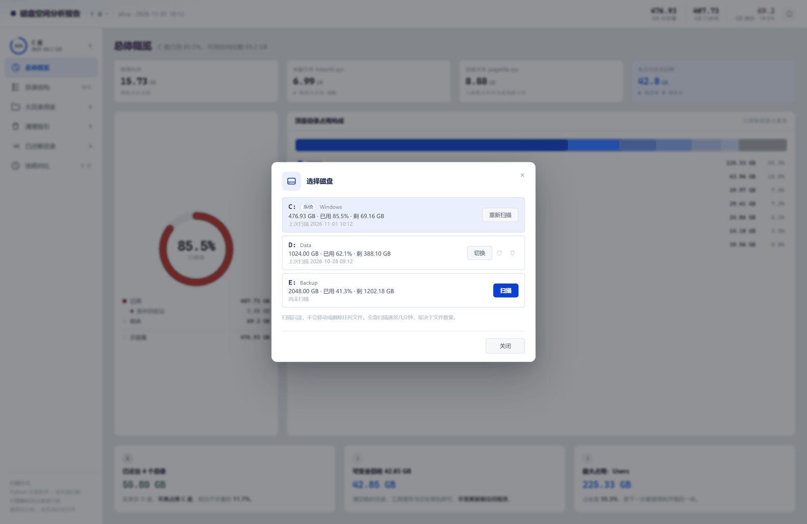

# 使用手册

[← 返回 README](../README.md) · [文字层与知识库](content-layer.md) · [架构与接口](architecture.md) · [开发指南](development.md)

启动、刷新、换盘、调整扫描门槛、打包离线版，以及常见问题的完整答案。
仓库无需安装，克隆或复制到任意目录即可运行；环境为 Windows 10 / 11 · PowerShell 5.1+ · Python 3.8+。

## 目录

- [启动与刷新](#启动与刷新)
- [命令行参数](#命令行参数)
- [换盘](#换盘)
- [扫描参数](#扫描参数)
- [离线单文件](#离线单文件)
- [常见问题](#常见问题)

## 启动与刷新

根目录的两个 `.bat` 只负责定位 Python 并转发给 `scripts\app.py`：

| 脚本 | 等价命令 | 说明 |
|---|---|---|
| `start.bat` | `python scripts\app.py` | 启动服务查看报告 |
| `update.bat` | `python scripts\app.py --update` | 刷新数据与文字层，先提示选择扫描盘；后台生成离线版，不启动服务、不打开浏览器 |

首次双击 `start.bat` 会提示选择磁盘，随后执行全量扫描（通常数分钟）、初始化知识库、
生成 ticket，并启动 Web 服务；后续启动仅执行三步：检查 ticket 是否被修改、导入已修改的
ticket、启动服务。

`update.bat` 的完整流程为：扫描 → 补齐文字层 → 生成 ticket → 后台重建
`dist\磁盘空间分析报告.html`。后台构建无需等待，日志写入 `data\.build.log`。
双击运行时结束后等待按键，以参数方式调用则直接退出。退出码 0 表示正常，
2 表示扫描失败但文字层仍按旧数据刷新完成。

## 命令行参数

参数直接透传：

```powershell
start.bat                        # 默认 8765；被占用时自动顺延到 8766、8767 …
start.bat --port 9000            # 指定端口（严格用这个，被占就直接报错）
start.bat --no-browser           # 不打开浏览器
start.bat -v                     # 打印每个请求
update.bat --skip-scan           # 不重扫，只刷新文字层
update.bat --no-build            # 刷新但不重新生成离线版
update.bat --no-ask              # 不提示选盘，直接用默认盘
update.bat --limit 40            # ticket 只输出 40 条，其余进入下一批
update.bat --keep-snapshots 128  # 快照保留上限（默认 64，0 = 不限）
```

`--skip-scan` 跳过整个扫描阶段（全盘 / 细化 / 链接），仅使用 `data\` 中已有的数据，
适合只补全文字层、或扫描耗时过长需要先查看现状的场景。数据缺失时直接报错，
不会静默生成空报告。

服务默认仅监听 `127.0.0.1`。除非明确了解风险，请勿通过 `--host` 绑定到局域网；
对外分享请使用离线单文件。

## 换盘

三种方式，按场景选择。

### 运行 `update.bat`

可双击，先列出本机磁盘供选择：

```text
  选择要刷新数据的磁盘（本机 3 个）：

  1) C: · Windows · 476.93 GB · 已用 85.5% · 剩 69.16 GB · 上次扫描 11-01 10:12  [默认 · 系统盘]
  2) D: · Data · 1024.00 GB · 已用 62.1% · 剩 388.10 GB · 尚未扫描
  3) E: · Backup · 2048.00 GB · 已用 41.3% · 剩 1202.18 GB · 上次扫描 10-28 09:12
```

回车接受默认项（上次扫描的盘），也可输入序号或盘符，`q` 退出。在脚本中调用且不希望
交互时加 `--no-ask`；`update.bat --drive D:` 直接跳过提示。

### 页面切换

服务启动后点击顶栏盘符（如 `C 盘`），弹窗列出本机所有固定磁盘：容量、已用比例、
上次扫描时间。已扫描的盘可直接切换或就地重扫；未扫描的盘直接开始扫描。
阶段、耗时、日志尾部均在弹窗中显示，扫描完成后自动刷新到新盘。



扫描期间可关闭弹窗继续浏览其他面板，顶栏持续显示「D: · 扫描中」。点击「中止扫描」
可随时终止：采集中止只会在 `data\.tmp` 留下中间产物，`data\` 中的正式数据在整形成功前
不会被替换。

### 命令行

无界面场景使用以下参数：

```powershell
update.bat --drive D: --detail-root D:\Work   # 重扫 D 盘，并把 D:\Work 作为细化根
update.bat --no-ask                           # 用默认盘（上次扫描的盘），不提示
start.bat --drive D: --rescan                 # 重扫 D 盘后启动服务
```

`--drive` 只接受盘符（`D:`）—— 传入目录会生成选盘弹窗无法列出的留档；需要细化某个
目录时使用 `--detail-root`，默认为当前用户家目录。细化根必须位于扫描盘内，否则自动
跳过 —— 盘外目录无法并入全盘树。界面扫描非系统盘时不做细化，因为默认细化根
（用户家目录）不在该盘上。

## 扫描参数

启动器默认先提示选择扫描盘（`--drive` / `--no-ask` 时不提示）；未指定时使用默认盘
（上次扫描的盘，若无则用系统盘），细化根取当前用户家目录。启动器与采集脚本接受
同一组参数：

```powershell
update.bat --drive D: --depth 4 --min-mb 80 --skip-links  # 启动器：换盘 + 调门槛
powershell -File scripts\collect\update-data.ps1                     # 默认
powershell -File scripts\collect\update-data.ps1 -Drive D:           # 换盘
powershell -File scripts\collect\update-data.ps1 -DetailRoot D:\Work # 换细化根目录
powershell -File scripts\collect\update-data.ps1 -Depth 4            # 盘根下保留 4 层（默认 6）
powershell -File scripts\collect\update-data.ps1 -MinMB 80           # 目录收录门槛（默认 40 MB）
powershell -File scripts\collect\update-data.ps1 -FileMinMB 50       # 单文件收录门槛（默认 20 MB）
powershell -File scripts\collect\update-data.ps1 -DetailMinMB 20     # 细化目录门槛（默认 12 MB）
powershell -File scripts\collect\update-data.ps1 -SkipLinks          # 不测链接目标体积，速度更快
powershell -File scripts\collect\update-data.ps1 -KeepSnapshots 128  # 快照保留上限（默认 64，0 = 不限）
powershell -File scripts\collect\update-data.ps1 -Clean              # 完成后清理中间产物
```

`-Depth` 以盘根为第 0 层。`DetailRoot` 位于扫描盘内时，细化扫描深度会先减去它相对盘根
的层数，合并后整棵树仍不超过 `-Depth`；不在扫描盘内则独立扫描。细化根还必须能在全量树
中保留（达到 `-MinMB`），否则细化结果不会合并。

静态树只保留达到目录门槛的分支，其中收录达到文件门槛的文件，门槛之下的碎项计入
「其余零散项」。按需下钻只在静态树完全没有子项时触发，即 6 层边界的深层内容、
或门槛之下未入档的目录；已有子项的目录不会为碎项重新扫描。

采集脚本只负责产出数字，不涉及文字层。

## 离线单文件

```powershell
python scripts\build.py                  # 产物在 dist\
python scripts\build.py -o "D:\报告.html"
```

产出 `dist\磁盘空间分析报告.html`，单文件，双击即可打开（`file://`）。**本机扫过的每个
盘都内嵌其中**，图表库一并内联，无任何外链；右上角的磁盘按钮仍可切换（切换只是重新
加载一份内嵌数据，不读磁盘、也不能扫描）。内嵌哪些盘取决于 `data/drives/` 中哪些盘有
`tree.json`，默认先显示 `active.json` 记录的盘。离线版不支持实时下钻，需要继续深挖目录
请用 `start.bat` 启动服务。

`update.bat` 默认会异步调用此构建（`--no-build` 可跳过），但只写默认文件名；用 `-o`
自定义过路径的仍需手动重新执行。构建先写 `.new` 再原子替换，后台更新时不会产生不完整
的文件。

离线单文件包含快照对比的降级版：总量趋势、最近一次对比、Top 变动路径的趋势。
任意两版对比与任意目录趋势需要本地服务。

## 常见问题

**打开 `web\index.html` 提示没有数据**

页面需要服务提供数据。通过 `start.bat` 启动，或使用 `dist\` 中的离线单文件。

**ticket 填完放回去没生效**

只有指纹匹配才会导入。常见两种情况：文件保存成了其他编码（须为 UTF-8），或者 AI 修改了
标题、重排了小节 —— 规则中「其他一个字都不要动」即为保护指纹而设。改坏了也不丢失
数据：删除该盘的 `ticket.md` 并重启，会按当前缺口重新生成。

**ticket 里没有我关心的目录**

可能体积太小（< 8 MB）、是随机命名的临时目录，或者已经有精确说明。手动在 `exact` 中
添加一条即可。

**某个目录没有用途说明**

规则库未匹配到。在 `content\drives\<盘>\purpose.json` 的 `exact` 中补一条，
或等下一次 ticket 列出它。

**报告里的账户名、盘符不是我本机的**

重新执行 `update.bat`。路径全部来自本次扫描结果，不会残留旧值。

**提示端口上跑着另一个 DiskAudit**

默认端口 8765 被别的程序占用时，`start.bat` 会自动顺延到下一个空闲端口，并在窗口里
打印实际地址（浏览器也开在新地址上），不用手动换端口。顺延路上如果遇到**本目录**已经
在跑的 DiskAudit，就直接打开它、不再起第二个进程。

显式写了 `--port 9000` 则严格按指定端口来：被占就报错并给出可用的替代端口，不会
静默换掉 —— 脚本、书签、防火墙规则可能写死了它。报「端口 9000 被占用」时按提示
换一个即可。

**能否把服务开放给别人**

不能。服务只监听 `127.0.0.1`，也请勿把 `--host` 改为 `0.0.0.0`。分享请使用离线单文件。

**PowerShell 报参数默认值异常**

`.ps1` 必须保存为 UTF-8 with BOM。Windows PowerShell 5.1 按 ANSI 解码无 BOM 的文件，
中文注释乱码后会污染 `param()` 默认值；症状是显式传参正常、仅默认值静默失效。

**跑 `.bat` 报「'xxx' 不是内部或外部命令」**

`.bat` 必须保存为 GBK（cp936）无 BOM，与 `.ps1` 正好相反。cmd.exe 按 ANSI 读取批处理，
UTF-8 无 BOM 的中文会错位，甚至把一条 `rem` 注释从中间截断、后半截当作命令执行。
命令行本身是 ASCII，脚本仍会运行完成，只是每次多输出两条错误。

**想把知识库带到另一台机器**

复制 `content\drives\` 下对应盘的目录即可；其中若混有上一台机器特有的条目，
页面会自动跳过路径对不上的部分，不报错。如需清空，删除该目录后重启，
程序会按当前缺口重新生成。
